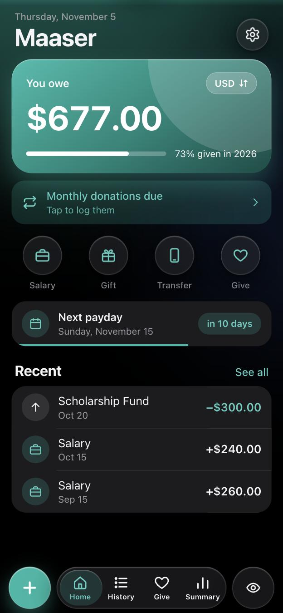
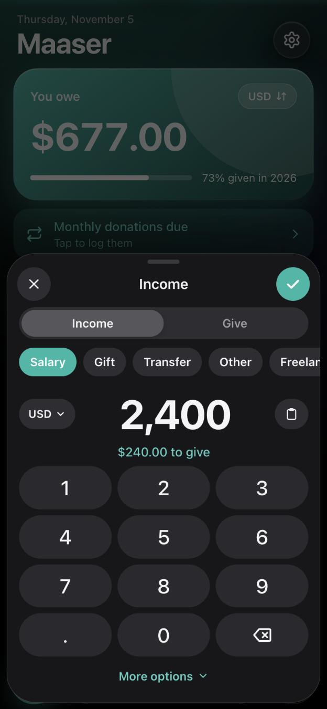
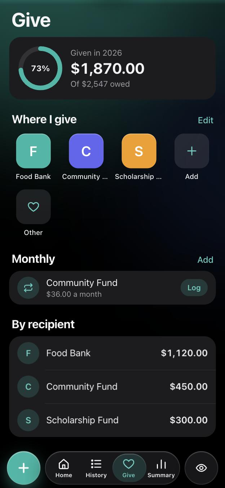
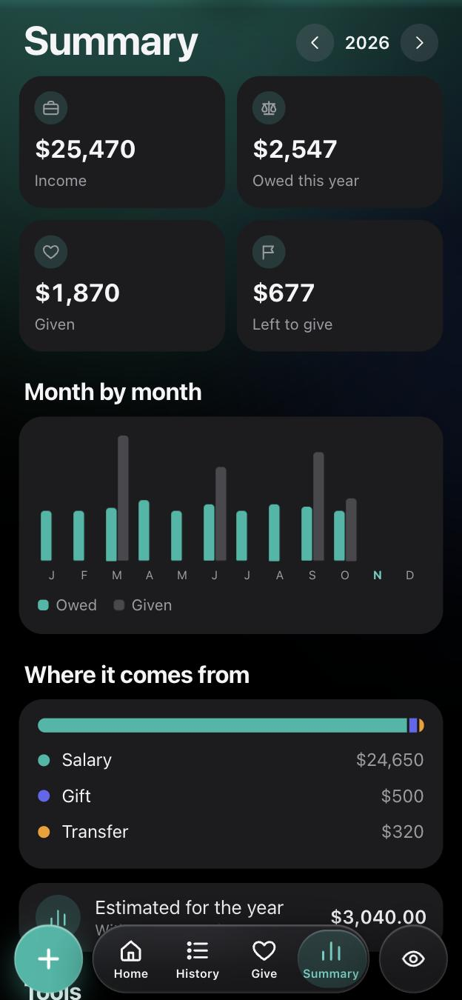

<p align="center"></p>

<h1 align="center">Maaser</h1>

<p align="center">A private, installable tracker for maaser, the practice of giving a share of what you earn.</p>

<p align="center">
  <a href="https://jfridzon.github.io/Maaser/">Open the app</a> ·
  <a href="docs/INSTALL.md">Install</a> ·
  <a href="docs/WIDGETS.md">Widgets</a> ·
  <a href="docs/ARCHITECTURE.md">Architecture</a>
</p>

<p align="center">
  
  
  
  
</p>

## Why

Tracking maaser usually means a running note and mental math every payday. Maaser replaces that with a phone app that knows what you owe, remembers where you give, and stays free: no account, no subscription, no ads and no server. Screenshots use sample data.

## Features

- **Balance at a glance:** income adds your percentage, donations subtract it, and amounts stay hidden until you tap the eye.
- **Any currency:** log in one currency and track in another, with a built-in converter. Live rates cover about 165 currencies, plus the three bolívar rates people use in Venezuela: BCV official, parallel and Binance USDT.
- **Giving made quick:** save your donation sites with a color and logo, then open one and log the gift in a single tap. Monthly donations are tracked too.
- **Year in review:** month-by-month chart, income sources, year-end estimate, balance check and CSV export.
- **Yours to shape:** English or Spanish, custom income categories, any accent color, left or right-hand controls, and pay schedules from weekly to monthly.
- **Works like an app:** installs to the Home Screen, runs offline, and adds Home Screen buttons through iOS Shortcuts.
- **Your data stays yours:** it lives on your phone, with an optional copy in your own private GitHub repository.

## Get started

1. Open **<https://jfridzon.github.io/Maaser/>** in Safari on your iPhone.
2. Tap Share, then **Add to Home Screen**.
3. Open Maaser from the Home Screen and follow the welcome screen.

That is all you need. These are optional:

| Add-on | What you get | Guide |
| --- | --- | --- |
| Backup | A copy of your data, and sync across devices | [docs/INSTALL.md](docs/INSTALL.md#backup-and-sync) |
| Widget buttons | Log income or a donation without opening the app | [docs/WIDGETS.md](docs/WIDGETS.md) |
| Notifications | Payday reminders | [docs/NOTIFICATIONS.md](docs/NOTIFICATIONS.md) |
| Your own copy | Host the app yourself for free | [docs/INSTALL.md](docs/INSTALL.md#host-your-own-copy) |

**Setting this up with an AI assistant?** Point it at [AGENTS.md](AGENTS.md), which lists each step, what it can do for you, and what only you can do.

## How it is built

Plain HTML, CSS and JavaScript modules, with no framework, no build step and no dependencies. The app is a static site, so it runs on any free host.

```text
js/core.js      Pure logic: ledger, currency math, pay schedules (unit tested)
js/app.js       Screens, sheets and interactions
js/liquid.js    Spring physics for the glass controls
js/rates.js     Live exchange rates
js/sync.js      Optional GitHub backup
js/i18n.js      English and Spanish strings
tools/          iPhone Shortcuts builder and payday notification job
```

The ledger is append-only: each entry is an immutable file, and deleting one adds a `void` event. That is why the phone and the Shortcuts can both write without conflicts. More in [docs/ARCHITECTURE.md](docs/ARCHITECTURE.md).

## Development

```bash
git clone https://github.com/jfridzon/Maaser.git
cd Maaser
npm test
npm start
```

`npm start` serves the app at <http://localhost:8080>. Tests use Node's built-in runner, so there is nothing to install. They also check that every string exists in every language.

## Limits worth knowing

- This is a web app, so the glass effect is an approximation. True refraction is only available to native apps, as explained in [docs/ARCHITECTURE.md](docs/ARCHITECTURE.md#liquid-glass-on-the-web).
- Maaser cannot see your bank. You log income yourself, and your bank's own alerts are what confirm a deposit.
- Exchange rates come from third parties and can be delayed. Check them before relying on a figure.
- Maaser is a calculator, not religious or financial advice. Ask your rabbi how to calculate what you owe.

## Credits

Exchange rates: [ExchangeRate-API](https://www.exchangerate-api.com), [DolarApi](https://dolarapi.com) and [CriptoYa](https://criptoya.com). Site logos: DuckDuckGo icons.

## License

[MIT](LICENSE)
